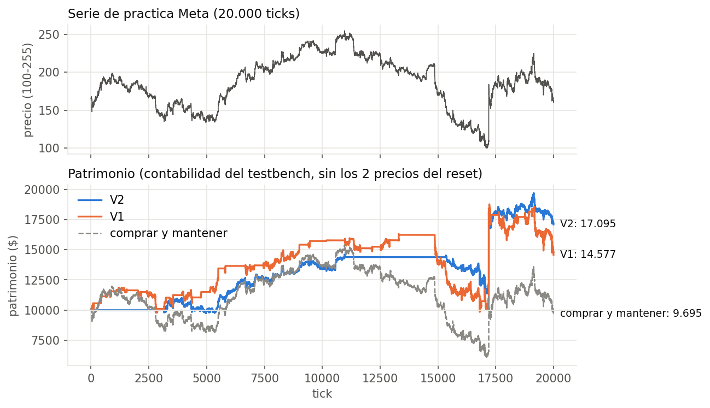
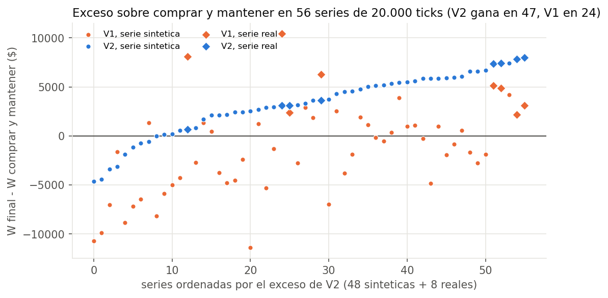

# 4.1 Algoritmo de predicción y decisión

Todo número de esta sección sale de `docs/informe/datos/` (`resumen_algoritmo.txt`,
`banco_ronda{1,2,3}.{txt,csv}`), generado con los scripts de `ref/` indicados en cada caso.

## Qué se optimiza

La competencia puntúa el patrimonio final de cada ronda **respecto a comprar y mantener** y el
**puesto entre los grupos**. Cada ronda tiene 20.000 ticks de una acción distinta (Meta, Apple,
Netflix, AMD o Tesla, 2022–2024), normalizados a 100–255. Por eso buscamos un algoritmo **robusto**:
que le gane a comprar y mantener en la mayoría de las series y que no tenga una ronda desastrosa. El
mejor caso en la serie de práctica importa menos.

## Lo que muestran los datos

Medido en las dos series de práctica (`ref/series.py`):

- **El precio es una escalera de enteros.** Alrededor del 60 % de los ticks no cambia.
- **Hay rebote inmediato, pero no se puede aprovechar.** Tras una bajada de 1, el tick siguiente
  sube el 27 % de las veces y baja el 12 %. Pero nuestra orden se ejecuta en el tick siguiente,
  justo después del rebote. Desde ahí la ganancia esperada es +0,04 unidades (unos \$2 con 60
  acciones), menos que los \$10 de comisión de ida y vuelta. La literatura coincide: la reversión de
  1 minuto suele desaparecer con los costos. Hay que capturar movimientos de varios ticks.
- **El rango está acotado.** Cada ronda se normaliza para que su mínimo sea 100 y su máximo 255.
  Cerca de 100 el precio casi no puede bajar más, y cerca de 255 casi no puede subir. Este dato viene
  del enunciado, no de información externa a la serie.

## Cómo evaluamos (sin sobreajustar)

No hay datos gratuitos de 1 minuto de 2022–2024 para esas acciones, así que el banco de evaluación
(`ref/banco.py`) usa 56 series de 20.000 ticks:

- **8 reales:** Meta y la serie anterior, cada una en 4 versiones: original, espejo
  (`min + max − p`, invierte la tendencia), reversa y ambas.
- **48 sintéticas** (`ref/series.py`): 51 días de 390 minutos con salto de apertura, volatilidad
  agrupada, tendencia al azar y rebote bid-ask, normalizadas igual que las del curso. Solo se aceptan
  si su % de ticks sin cambio, P(+1 | −1) y P(−1 | −1) caen en la banda de las reales.

Los parámetros se eligen **solo** con 24 sintéticas (*ajuste*) y se confirman con las otras 24
(*prueba*) y las 8 reales. La métrica principal imita la competencia: en cada serie, la fracción de
un grupo de rivales a los que se supera (comprar y mantener, no operar, V0, V1, momentum 8/64 y nivel
lineal).

Se probaron 598 configuraciones de 9 familias en tres rondas (285 + 183 + 130):

- reversión a la media;
- momentum;
- por nivel;
- nivel + reversión;
- filtro de saltos;
- cambio de régimen (eficiencia de Kaufman);
- ensamble "sigue al mejor";
- y, en las rondas 2 y 3, las versiones implementables sin división.

Mejor configuración de cada familia en la ronda 1 (puntaje 0–1 y exceso mediano sobre comprar y
mantener):

| Familia | Mejor configuración | Puntaje ajuste | Puntaje prueba | Mediana prueba | Peor prueba | Mediana reales |
|---|---|---:|---:|---:|---:|---:|
| Por nivel | 100–255, cuadrática | 0,875 | 0,868 | 3.335 | −6.429 | 4.728 |
| Nivel + reversión | raíz, SMA16, U = 3 | 0,757 | 0,743 | 1.288 | −3.282 | 1.684 |
| Reversión a la media | SMA8, U = 5, 2 lotes | 0,639 | 0,597 | 36 | −13.601 | 3.542 |
| Cambio de régimen | N = 64, ER ≥ 10/16, base nivel | 0,611 | 0,611 | 488 | −7.647 | 3.452 |
| Sigue al mejor | olvido 2^-9, costo 256 | 0,549 | 0,458 | −875 | −4.976 | −472 |
| Momentum | 16/128 | 0,486 | 0,424 | −812 | −12.320 | −2.854 |
| V1 (referencia) | SMA16, U = 3, 2 lotes | 0,438 | 0,465 | −1.220 | −11.395 | 5.004 |

V1, que elegimos primero con la serie de práctica, **gana en las reales pero pierde en las
sintéticas**: es un pico de parámetros (con U = 2 o U = 4 rinde mucho peor) y en una tendencia queda
fuera del mercado o compra caídas que siguen cayendo. Las rondas 2 y 3 afinaron la familia por nivel
en su versión implementable. Hay una **meseta**: las variantes cuadráticas con q = 40 y extremos
entre 95–110 (abajo) y 245–255 (arriba) dan puntajes de 0,90 a 0,95 en el ajuste. Corriendo el
extremo de arriba a 260, fuera del rango real, bajan a 0,81–0,87. Elegimos exactamente 100–255, que
son los límites de la normalización, en vez del pico (105–255, 0,951), para no afinar a mano un
parámetro que el enunciado ya define.

## El algoritmo final: V2

**Idea.** La fracción del patrimonio invertida en acciones apunta a una función del nivel del
precio. Cerca de 100 se está casi todo adentro, porque no queda mucho por bajar, y cerca de 255 casi
todo afuera, porque no queda mucho por subir:

> exposición objetivo = (r / D)², con r = clamp(255 − p, 0, 155) y D = 155

Así queda en 100 % con p = 100, 25 % con p = 177 y 0 % con p = 255. Es un "compra barato, vende
caro" que no necesita predecir la dirección del próximo tick, solo saber dónde está el precio dentro
del rango. La forma cuadrática es más cauta en la mitad alta del rango y le ganó a la lineal y a la
raíz.

**Cómo decide q.** Siempre órdenes de **q = 40 acciones**, solo si siguen dejando la exposición del
lado correcto del objetivo:

- compra 40 si `caja ≥ 40p + 5` y `r²·W ≥ D²·(V + 40p)`;
- si no, vende 40 si `acc ≥ 40` y `r²·W ≤ D²·(V − 40p)`;
- si no, mantiene.

Acá W = caja + acc·p y V = acc·p. Entre las dos condiciones queda una banda muerta de 40 acciones,
que evita comprar y vender por ruido. q = 40 fue el mejor balance: con q = 63 gana más en las
sintéticas, pero pierde en 2 de las 8 reales; con q chico paga demasiadas comisiones. Como nunca pide
más caja ni más acciones de las que tiene, **la maestra nunca recorta las órdenes** y el programa
lleva una copia exacta de su caja y sus acciones.

**Implementable en Espino.** No hay división: la exposición se compara escalada. Los productos
caben en 32 bits sin signo mientras W < 170.000. Las multiplicaciones se hacen con sumas y dobleces.
Lo implementa la clase `V2` de `ref/trader.py`, y `sw/trade.s` replica exactamente esa clase.

## Comparación con las referencias

Serie de práctica Meta completa (20.000 ticks, como en la placa, sin los precios perdidos en el
reset de la simulación):

| Estrategia | Patrimonio final | Órdenes | Comisiones | Pérdida máxima |
|---|---:|---:|---:|---:|
| **V2 (final)** | **17.095** | 5 | 25 | 3.215 |
| V1 | 14.577 | 178 | 890 | 6.455 |
| V0 (kit de la prueba) | 9.269 | 297 | 1.485 | 7.580 |
| No operar | 10.000 | 0 | 0 | 0 |
| Comprar y mantener | 9.695 | 1 | 5 | 9.300 |

Exceso sobre comprar y mantener por conjunto de series:

| Conjunto | Estrategia | Mediana | Peor | Gana a comprar y mantener | Órdenes (media) |
|---|---|---:|---:|---:|---:|
| Ajuste (24 sintéticas) | **V2** | 2.687 | −4.419 | 20/24 | 4 |
| Ajuste | V1 | −2.730 | −9.909 | 7/24 | 177 |
| Prueba (24 sintéticas) | **V2** | 4.016 | −4.645 | 19/24 | 4 |
| Prueba | V1 | −1.220 | −11.395 | 9/24 | 165 |
| Reales (8) | **V2** | 5.498 | 650 | 8/8 | 5 |
| Reales | V1 | 5.004 | 2.158 | 8/8 | 204 |

**Cuándo pierde V2.** Pierde en una serie que arranca alta y sube con fuerza hasta 255, porque
estaba poco invertido mientras comprar y mantener sube con todo. Es su peor caso, de −4.400 a −4.600
en las sintéticas. Probamos agregarle una componente de tendencia (media de 256 o 1.024 ticks), y
mejoró ese peor caso pero empeoró el resto en el set de prueba, así que no la incluimos.

**Riesgo declarado.** V2 usa que el rango de cada ronda es 100–255. Si el curso decidiera que no se
puede usar ese dato, el respaldo es V1 (`sw/trade_v1.s`, validado igual).
