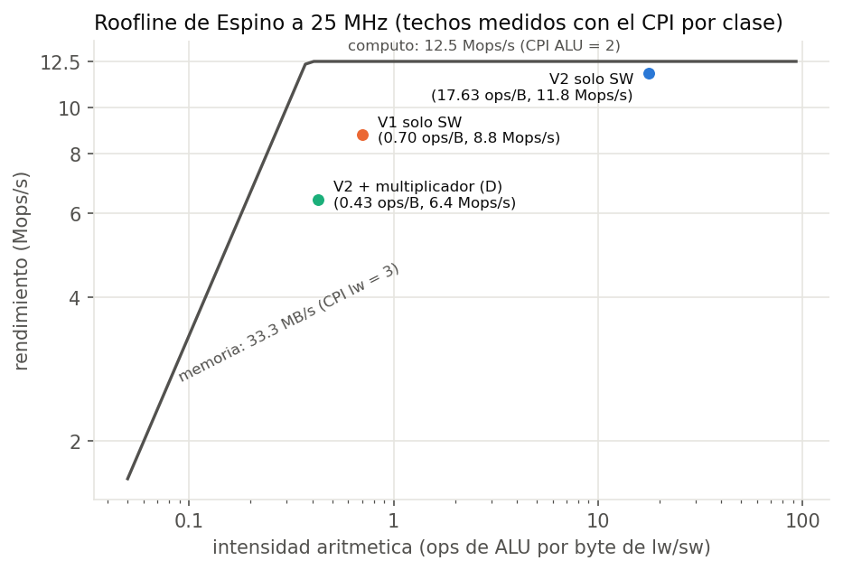

# 4.3 Co-diseño hardware/software

De dónde salen los números:

- LC, BRAM y fmax: `docs/variantes/variantes.txt` (`bash docs/variantes/medir_variantes.sh`, Yosys
  0.33 y nextpnr 0.6, `--hx1k --package vq100 --seed 1`, un log por variante en su carpeta);
- ciclos, IC y CPI: `docs/mediciones/*_ticks.csv` (`make medir`);
- Amdahl, Ops/s y roofline: `docs/mediciones/resumen.md` (`ref/mediciones.py`).

## Dónde se van los ciclos (profiling)

La sonda `sim/sonda_p4.sv` atribuye cada ciclo a la instrucción que está en ID, por PC. Los ciclos
sin instrucción válida (burbujas tras un salto tomado) se cuentan aparte. Todo se mide en la serie
de estrés (`docs/mediciones/estres_serie.csv`), que recorre todos los caminos del programa.

**Primera versión de V2** (`sw/trade_v2a.s`): la multiplicación se llevaba el **75,9 %** de los
ciclos, más el 11,3 % de burbujas, casi todas de su bucle. Espino no tiene `mul`: cada producto era
un bucle de hasta 16 vueltas de 7 instrucciones.

**Primer paso de co-diseño, en software.** Dos de los cuatro productos por tick son por la constante
D² = 24.025. Los cambiamos por una cadena fija de 24 instrucciones (`mul_d2`, una suma por bit en 1 de la
constante). El resultado es exactamente el mismo, con mismas decisiones e IGUALES, y el tick
promedio baja de 727 a 527 ciclos (**1,38×**). El peor caso baja de 1.133 a 721 ciclos.

**V2 final** (`sw/trade.s`):

| Región de `sw/trade.s` | % de los ciclos |
|---|---:|
| subrutina `mul` (bucle de suma y doble, productos de dos variables) | 59,7 % |
| `mul_d2` (producto por D², cadena fija) | 13,7 % |
| burbujas tras saltos (en su mayoría, del bucle de `mul`) | 10,0 % |
| resto: leer el precio, actualizar la cuenta, decidir y escribir | 16,6 % |

**La multiplicación sigue siendo el cuello de botella**: ~73 % de los ciclos, o ~79 % con las
burbujas de su bucle. Por Amdahl, si las multiplicaciones fueran gratis, el tick sería como mucho
1/(1 − 0,79) = **4,8×** más rápido.

En V1, el algoritmo del kit, el reparto es otro:

- la actualización de la media móvil (`media`) se lleva el 31 % de los ciclos;
- armar 16·p con 4 sumas y comparar (`decide`), el 23 %.

## Liberar LUTs (L2)

| Variante | LC | Nota |
|---|---:|---|
| SoC actual con el contador de ciclos del P2 | 1.330/1.280 | **no cabe** |
| Sin contador (`CYCLE_COUNTER = 0`, diseño final) | 1.183/1.280 | ningún programa lo usaba |
| Sin contador + `RAM_NO_RW_CHECK` | 1.035/1.280 | −148 LC |

Con `RAM_NO_RW_CHECK`, yosys deja de emular las colisiones de lectura y escritura en la misma
dirección y el mismo ciclo de la RAM, que Espino nunca produce. Como Icarus ignora el atributo, se
validó **después de la síntesis** (`sim/postsintesis_ram.sh`): netlist de la RAM con el programa
cargado, más el testbench del curso, con 4/4 PASS e IGUALES (`docs/mediciones/postsintesis_*.log`).

## Alternativas implementadas

Cada una tiene su testbench propio en `sim/` y se validó con el testbench del curso y con
`--compara` (IGUALES).

- **A: PLL a 37,5 MHz** (`SOC_PLL`, `rtl/trade_top.v`). **No es viable en la Go Board.** El único PLL
  de la iCE40 HX1K no se puede colocar en el encapsulado VQ100: nextpnr dice "*PLL couldn't be placed
  anywhere*", y el mismo diseño mínimo sí se coloca en TQ144 (`docs/variantes/pll_vq100/`). Además, la
  fmax del diseño final es 38,7 MHz, así que el margen habría sido mínimo.
- **B: suma móvil en hardware** (`SOC_SMA`, `rtl/pochoco_sma.v`). Mantiene la suma de los últimos 16
  precios en una BRAM y se lee en SPI + 0x0C. Acelera V1 (`sw/trade_sma.s`). Testbench:
  `sim/tb_pochoco_sma.v` (3.000 precios contra un modelo, más casos borde; detecta mutaciones). IGUALES
  en los 20.000 ticks.
- **C: shifter** (`ESPINO_SHIFTER`, SLL en la ALU). Arma 16·p con un `slli` en vez de 4 sumas
  (`sw/trade_shift.s`, V1). Testbench: `sim/tb_espino_alu_shift.v` (todos los shamt, 2.000 operandos).
  Con SLL, SRL y SRA (`ESPINO_SHIFTER_FULL`) no cabe.
- **D: multiplicador secuencial** (`SOC_MUL`, `rtl/pochoco_mul.v`). Periférico mapeado en
  `0x8002_0000`: P = A·B, con A de 32 bits y B de hasta 16 bits. Hace suma y doble a 1 bit por ciclo
  y termina cuando B llega a 0. Uno combinacional de 16×16 no cabe en la HX1K, que no tiene DSP. Reemplaza la
  subrutina `mul` de V2 (`sw/trade_mul.s`). Testbench: `sim/tb_pochoco_mul.v` (3.007 productos, más
  tiempos y casos borde; detecta mutaciones). IGUALES en la serie de estrés (215 órdenes).

## Comparación

Operación útil para Ops/s:

- (1) **precio procesado**: capacidad = f / ciclos del peor tick;
- (2) para el roofline, **instrucción de ALU** del kernel (OP, OP-IMM, LUI o branch, fuera del
  bucle de espera), por byte de `lw`/`sw`.

| Variante | LC | BRAM | fmax (MHz) | Ciclos/tick prom. | Peor | CPI | Precios/s (peor) | Speedup medido | Amdahl |
|---|---:|---:|---:|---:|---:|---:|---:|---:|---:|
| V1 solo SW | 1.183 | 12 | 38,7 | 54,97 | 72 | 2,32 | 347.222 | 1 | — |
| V1 + B (suma móvil, nrw) | 1.128 | 13 | 42,6 | 42,86 | 59 | 2,42 | 423.729 | 1,273 | 1,281 |
| V1 + C (shifter, nrw) | 1.189 | 12 | 41,3 | 49,22 | 66 | 2,36 | 378.788 | 1,112 | 1,114 |
| V2a solo SW (`mul` general) | 1.183 | 12 | 38,7 | 727,16 | 1.133 | 2,26 | 22.065 | 1 | — |
| **V2 solo SW (final, `mul_d2`)** | **1.183** | 12 | 38,7 | 526,99 | 721 | 2,24 | 34.674 | 1,380 vs V2a | — |
| V2 + D (multiplicador, nrw) | 1.164 | 12 | 36,1 | 231,31 | 286 | 2,47 | 87.413 | 2,278 vs V2 (3,144 vs V2a) | 2,337\* |

Notas:

- Ciclos de V1 y sus variantes: primeros 1.998 ticks de Meta. Ciclos de V2a, V2 y D: serie de
  estrés, 1.998 ticks.
- \* Amdahl de D sobre V2 con p = 0,790: `mul` y `mul_d2` más las burbujas propias del bucle (las
  del programa SW menos las del programa HW, porque el resto del código es igual) y s = 3,63.
  Contando solo las instrucciones de las subrutinas (p = 0,734), predice 2,07. Lo medido (2,28) queda
  entre las dos.
- "nrw" = `RAM_NO_RW_CHECK`. Sin ese ahorro, B (1.294 LC) y D (1.362 LC) no caben.
- El multiplicador sube un poco el CPI (más `lw`/`sw` al MMIO, de CPI 3 y 2), pero baja tanto el IC
  (236 → 94 instrucciones por tick) que el tick se acelera 2,3×.
- Los LC no dependen del programa: V2a y V2 ocupan lo mismo. Solo cambia el contenido de la BRAM.

## Roofline

Techos de Espino medidos con el CPI por clase:

- cómputo: f / CPI_ALU = 25 MHz / 2 = **12,5 Mops/s**;
- memoria: 4 B · f / CPI_lw = **33,3 MB/s**;
- punto de quiebre: 0,375 ops/B.

| Kernel | Intensidad (ops/B) | Rendimiento (Mops/s) | Límite |
|---|---:|---:|---|
| V2 solo SW | 17,6 | 11,8 | cómputo (94 % del techo) |
| V1 solo SW | 0,70 | 8,8 | cómputo (cerca del quiebre) |
| V2 + multiplicador | 0,43 | 6,4 | junto al quiebre: domina el acceso al MMIO |

V2 solo SW está pegado al techo de cómputo: el bucle de multiplicación y la cadena de `mul_d2` son
ALU pura. El multiplicador
saca esas operaciones de Espino. Lo que queda es poco cómputo y bastante acceso al MMIO, así que el
kernel baja de intensidad, pero hace mucho menos trabajo por tick. El roofline mide qué tan bien usa
Espino sus recursos, no el tiempo total; el tiempo lo da la tabla anterior.

## Presupuesto por ronda

A 25 MHz los ciclos disponibles por tick son (T − 9,5 µs) · f: 249.762, 24.762 y **2.262**. El peor
tick de V2 solo SW es de 653 ciclos en Meta (**28,9 % de la ronda 3**) y de 721 en la serie de
estrés (31,9 %). Cabe en las tres rondas con margen. Además, `trade.s` escribe `DECISION = 0`
apenas lee el precio: si algún tick no alcanzara, lo que se repite es "mantener".

## Variante final

**V2 solo software** (diseño sin macros: sin contador, con botón de reset, 1.183 LC; fmax 38,7 MHz
con la semilla 1 del script de variantes y 36,8 MHz con la de `make`, PASS a 25 MHz en ambos casos).

- **Gana lo mismo que cualquier variante:** todas toman exactamente las mismas decisiones (IGUALES).
  El patrimonio depende solo del algoritmo.
- **Ya cumple el deadline con margen:** el peor tick usa el 29–32 % de la ronda 3, después de la
  optimización por software (`mul_d2`). La aceleración de D (2,3× más) no cambia ningún resultado de
  la competencia.
- **Es la de menor riesgo en la placa:** no usa `RAM_NO_RW_CHECK` ni periféricos nuevos en el camino
  del dato, y deja 97 LC libres.

Que la variante final sea solo software es también un resultado del co-diseño, no la ausencia de
uno. El profiling mostró que la multiplicación se llevaba el 75,9 % de los ciclos, y que la mitad de
los productos eran por la constante D². El primer paso fue en software: `mul_d2` dio 1,38× sin costo
de LUTs y dejó el peor tick en el 32 % del presupuesto de la ronda 3. El multiplicador D se
implementó y se midió (2,3× más), pero con ese margen ya no cambia ninguna decisión: solo agrega
lógica en el camino del dato y riesgo en la placa.

D es la mejor alternativa en rendimiento y en LUTs (más rápida y con menos LC gracias a nrw), y sería
la elegida si el algoritmo necesitara más multiplicaciones por tick. Por ejemplo, un ensamble de
varias exposiciones, que con software no cabría en la ronda 3.
